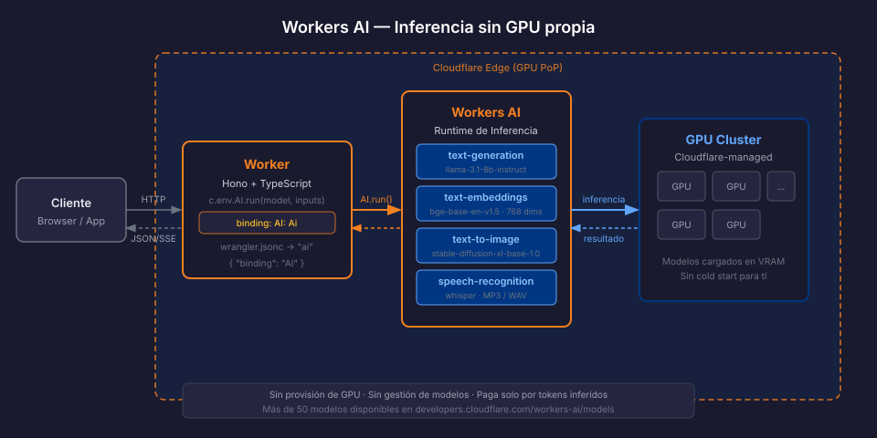

# Workers AI — Inferencia sin GPU propia

> 

## Objetivos

- Describir cómo Workers AI ejecuta inferencia en la red de Cloudflare
- Configurar el binding `AI` en `wrangler.jsonc` y tiparlo en TypeScript
- Identificar las categorías de modelos disponibles y cuándo usar cada una

## 1. Qué es Workers AI

Workers AI es un servicio de inferencia serverless que corre modelos de ML en
las GPUs de la infraestructura de Cloudflare. No necesitas provisionar ni pagar
GPUs: el Worker llama al binding `AI` y recibe la respuesta del modelo.

El modelo se ejecuta en el PoP de Cloudflare más cercano al Worker invocado,
reduciendo la latencia frente a APIs externas de AI.

## 2. Cómo se declara el binding

En `wrangler.jsonc`, una sola línea activa el acceso a todos los modelos:

```jsonc
{
  "name": "mi-worker",
  "main": "src/index.ts",
  "compatibility_date": "2025-01-01",
  "compatibility_flags": ["nodejs_compat_v2"],
  "ai": {
    "binding": "AI"
  }
}
```

En TypeScript, se tipa en `Bindings`:

```typescript
type Bindings = {
  AI: Ai; // tipo nativo de @cloudflare/workers-types
};
```

## 3. Categorías de modelos

| Categoría | Task Type | Ejemplo de modelo |
|-----------|-----------|-------------------|
| LLM texto | `text-generation` | `@cf/meta/llama-3.1-8b-instruct` |
| Embeddings | `text-embeddings` | `@cf/baai/bge-base-en-v1.5` |
| Imágenes | `text-to-image` | `@cf/stabilityai/stable-diffusion-xl-base-1.0` |
| Voz | `automatic-speech-recognition` | `@cf/openai/whisper` |

> Ver catálogo completo en [developers.cloudflare.com/workers-ai/models](https://developers.cloudflare.com/workers-ai/models/)

## 4. Primera llamada de inferencia

```typescript
import { Hono } from "hono";

type Bindings = { AI: Ai };
const app = new Hono<{ Bindings: Bindings }>();

// Devuelve un resumen de texto enviado en el body
app.post("/summarize", async (c) => {
  const { text } = await c.req.json<{ text: string }>();
  const result = await c.env.AI.run(
    "@cf/meta/llama-3.1-8b-instruct",
    {
      messages: [
        { role: "system", content: "Eres un asistente que resume textos." },
        { role: "user", content: `Resume en 2 oraciones: ${text}` },
      ],
    }
  );
  return c.json(result);
});

export default app;
```

`c.env.AI.run(modelName, inputs)` devuelve una respuesta tipada según la
categoría del modelo. TypeScript infiere el tipo de `result` correctamente.

## ✅ Checklist

- [ ] ¿Cómo se declara el binding AI en `wrangler.jsonc`?
- [ ] ¿Qué tipo TypeScript representa el binding AI en `Bindings`?
- [ ] ¿Qué task type usa el modelo Llama para generación de texto?
- [ ] ¿En qué PoP de Cloudflare se ejecuta la inferencia?

## Referencias

- [Workers AI · Overview](https://developers.cloudflare.com/workers-ai/)
- [Models catalog](https://developers.cloudflare.com/workers-ai/models/)
