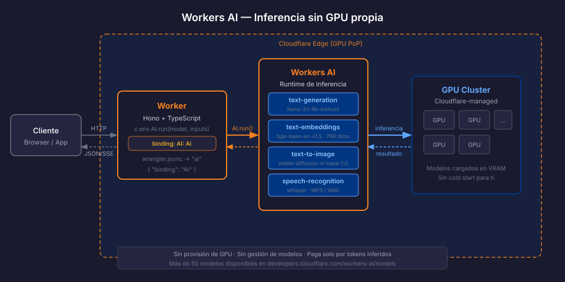

# Generación de Texto y Streaming con SSE

> 

## Objetivos

- Enviar prompts a un LLM y recibir la respuesta completa o en streaming
- Implementar Server-Sent Events (SSE) con Hono para tokens progresivos
- Controlar el comportamiento del modelo con parámetros clave

## 1. Respuesta completa vs. streaming

Workers AI soporta dos modos para LLMs:

| Modo | Cuándo usarlo | Cómo |
|------|---------------|------|
| Completo | Pipelines batch, APIs simples | `stream: false` (default) |
| Streaming | Chatbots, UX responsiva | `stream: true` → `ReadableStream` |

En modo streaming el modelo devuelve un `ReadableStream` con fragmentos SSE.
El cliente recibe tokens a medida que se generan, sin esperar la respuesta completa.

## 2. Respuesta completa

```typescript
// Genera una respuesta completa y la devuelve en JSON
app.post("/chat", async (c) => {
  const { message } = await c.req.json<{ message: string }>();
  const response = await c.env.AI.run(
    "@cf/meta/llama-3.1-8b-instruct",
    {
      messages: [
        { role: "system", content: "Responde siempre en español." },
        { role: "user", content: message },
      ],
      max_tokens: 512,
    }
  );
  // response.response contiene el texto generado
  return c.json({ reply: (response as { response: string }).response });
});
```

## 3. Streaming con SSE

```typescript
// Devuelve tokens progresivos vía Server-Sent Events
app.post("/chat/stream", async (c) => {
  const { message } = await c.req.json<{ message: string }>();
  const stream = await c.env.AI.run(
    "@cf/meta/llama-3.1-8b-instruct",
    {
      messages: [
        { role: "system", content: "Responde siempre en español." },
        { role: "user", content: message },
      ],
      stream: true,
    }
  );
  // Devuelve el ReadableStream directamente con Content-Type SSE
  return new Response(stream as ReadableStream, {
    headers: {
      "Content-Type": "text/event-stream",
      "Cache-Control": "no-cache",
    },
  });
});
```

El cliente consume el stream con `EventSource` o `fetch` + `getReader()`.
Cada evento tiene el formato: `data: {"response":"token"}\n\n`.

## 4. Parámetros del modelo

| Parámetro | Tipo | Efecto |
|-----------|------|--------|
| `max_tokens` | number | Límite de tokens en la respuesta (default: 256) |
| `temperature` | 0.0–2.0 | Aleatoriedad: 0 = determinista, 2 = caótico |
| `stream` | boolean | Activa el modo streaming |

> Un system prompt bien definido es la forma más efectiva de controlar el comportamiento del modelo.

## ✅ Checklist

- [ ] ¿Qué tipo devuelve `AI.run()` cuando `stream: true`?
- [ ] ¿Qué `Content-Type` debe tener la respuesta SSE?
- [ ] ¿Qué campo del objeto respuesta contiene el texto generado?
- [ ] ¿Qué parámetro controla la longitud máxima de la respuesta?

## Referencias

- [Workers AI · Text Generation](https://developers.cloudflare.com/workers-ai/models/text-generation/)
- [Streaming · Workers AI](https://developers.cloudflare.com/workers-ai/configuration/streaming/)
