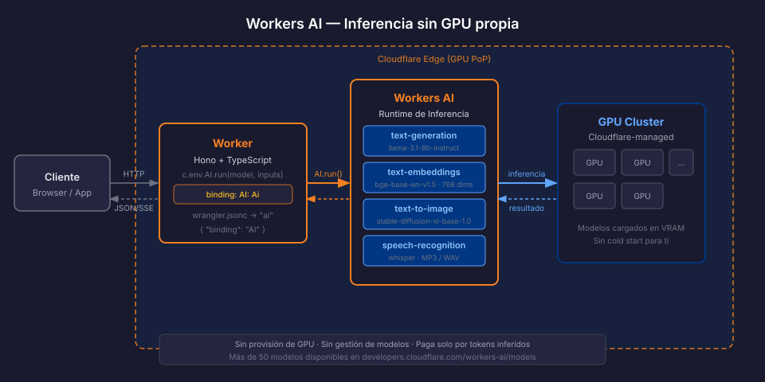

# Embeddings de Texto — Representaciones Vectoriales

> 

## Objetivos

- Entender qué es un embedding y para qué se usa en búsqueda semántica
- Generar vectores de texto con el modelo `@cf/baai/bge-base-en-v1.5`
- Calcular similitud coseno para encontrar textos relacionados

## 1. Qué es un embedding

Un embedding es un vector numérico que representa el *significado* de un texto.
Frases semánticamente similares producen vectores cercanos en el espacio vectorial.

```
"El perro corre" → [0.12, -0.34, 0.87, ...]  ← 768 dimensiones
"El can trota"   → [0.13, -0.31, 0.84, ...]  ← cercano al anterior
"La factura vence" → [-0.45, 0.22, -0.60, ...]  ← lejano
```

Los embeddings son la base de los sistemas RAG (semanas 11–13): se almacenan
en Vectorize y se comparan contra la query del usuario en cada request.

## 2. Generar embeddings con Workers AI

```typescript
// Devuelve el vector de 768 dimensiones del texto recibido
app.post("/embeddings", async (c) => {
  const { text } = await c.req.json<{ text: string }>();
  const result = await c.env.AI.run(
    "@cf/baai/bge-base-en-v1.5",
    { text }
  );
  // result.data[0] es el vector Float32[] de 768 dimensiones
  return c.json({ vector: result.data[0], dimensions: result.data[0].length });
});
```

> El modelo acepta `text` como string o array de strings (batch).
> Para batch: `{ text: ["frase1", "frase2"] }` → `result.data[0]`, `result.data[1]`

## 3. Similitud coseno

Mide qué tan parecidos son dos vectores. Rango: -1 (opuestos) a 1 (idénticos).

```typescript
// Calcula la similitud coseno entre dos vectores
function cosineSimilarity(a: number[], b: number[]): number {
  const dot = a.reduce((sum, val, i) => sum + val * b[i], 0);
  const normA = Math.sqrt(a.reduce((sum, val) => sum + val * val, 0));
  const normB = Math.sqrt(b.reduce((sum, val) => sum + val * val, 0));
  return dot / (normA * normB);
}

// Ejemplo: comparar query con textos pre-computados
app.post("/search", async (c) => {
  const { query, candidates } = await c.req.json<{
    query: string;
    candidates: string[];
  }>();
  const allTexts = [query, ...candidates];
  const { data } = await c.env.AI.run("@cf/baai/bge-base-en-v1.5", {
    text: allTexts,
  });
  const queryVec = data[0];
  const scores = candidates.map((text, i) => ({
    text,
    score: cosineSimilarity(queryVec, data[i + 1]),
  }));
  scores.sort((a, b) => b.score - a.score);
  return c.json({ results: scores });
});
```

## 4. Flujo típico en producción

En producción no se recomputan los embeddings en cada request:

1. **Ingesta**: calcular embeddings al guardar el documento → almacenar en Vectorize o D1
2. **Búsqueda**: calcular embedding de la query → comparar con los almacenados
3. **Resultado**: devolver los N documentos más cercanos

Este patrón es la base del pipeline RAG completo de la Semana 13.

## ✅ Checklist

- [ ] ¿Cuántas dimensiones tiene el vector de `bge-base-en-v1.5`?
- [ ] ¿Qué propiedad del resultado contiene el array de vectores?
- [ ] ¿Qué valor de similitud coseno indica textos idénticos?
- [ ] ¿Por qué se pre-computan los embeddings en lugar de calcularlos en cada request?

## Referencias

- [Workers AI · Text Embeddings](https://developers.cloudflare.com/workers-ai/models/text-embeddings/)
- [bge-base-en-v1.5](https://developers.cloudflare.com/workers-ai/models/bge-base-en-v1.5/)
