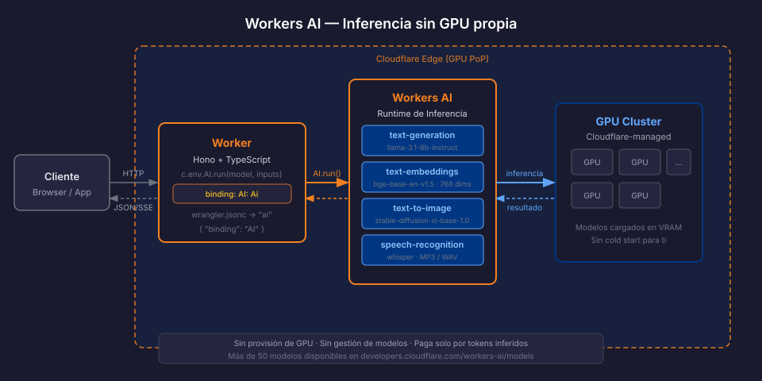

# Visión y Voz — Modelos Multimodales

> 

## Objetivos

- Generar imágenes a partir de texto con Stable Diffusion XL
- Clasificar imágenes usando ResNet-50
- Transcribir audio a texto con el modelo Whisper

## 1. Generación de imágenes (text-to-image)

El modelo devuelve un `ReadableStream` con los bytes de la imagen PNG.
Se sirve directamente al cliente con `Content-Type: image/png`.

```typescript
// Genera una imagen PNG a partir de un prompt de texto
app.get("/image", async (c) => {
  const prompt = c.req.query("prompt") ?? "a futuristic city at sunset";
  const image = await c.env.AI.run(
    "@cf/stabilityai/stable-diffusion-xl-base-1.0",
    { prompt }
  );
  return new Response(image, {
    headers: { "Content-Type": "image/png" },
  });
});
```

> El modelo acepta también `negative_prompt` para excluir elementos del resultado.

## 2. Clasificación de imágenes

Recibe los bytes de la imagen como `ArrayBuffer` y devuelve un array de
etiquetas con su puntaje de confianza.

```typescript
// Clasifica la imagen enviada como multipart/form-data
app.post("/classify", async (c) => {
  const form = await c.req.formData();
  const file = form.get("image") as File;
  const bytes = await file.arrayBuffer();
  const result = await c.env.AI.run(
    "@cf/microsoft/resnet-50",
    { image: [...new Uint8Array(bytes)] }
  );
  // result es un array [{ label, score }, ...]
  return c.json({ predictions: result });
});
```

## 3. Transcripción de audio (speech-to-text)

Whisper convierte un archivo de audio (MP3, WAV, OGG) a texto.
Devuelve el texto transcrito y, opcionalmente, segmentos con timestamps.

```typescript
// Transcribe el audio enviado como multipart/form-data
app.post("/transcribe", async (c) => {
  const form = await c.req.formData();
  const audio = form.get("audio") as File;
  const bytes = await audio.arrayBuffer();
  const result = await c.env.AI.run(
    "@cf/openai/whisper",
    { audio: [...new Uint8Array(bytes)] }
  );
  // result.text contiene la transcripción completa
  return c.json({ transcript: result.text });
});
```

## 4. Manejo de binarios en Workers

| Tipo de entrada | Conversión necesaria |
|-----------------|----------------------|
| `File` (FormData) | `file.arrayBuffer()` → `new Uint8Array(bytes)` |
| URL remota | `fetch(url)` → `res.arrayBuffer()` → `Uint8Array` |
| Base64 | `atob(str)` → `Uint8Array.from(...)` |

> Para servir imágenes generadas como caché, usa la `Cache API` estudiada en la Semana 4.

## ✅ Checklist

- [ ] ¿Qué tipo devuelve `AI.run()` con el modelo Stable Diffusion XL?
- [ ] ¿Qué formato de datos acepta ResNet-50 para clasificar una imagen?
- [ ] ¿Qué propiedad del resultado de Whisper contiene el texto transcrito?
- [ ] ¿Cómo conviertes un `ArrayBuffer` al formato que aceptan los modelos de visión?

## Referencias

- [Workers AI · Image models](https://developers.cloudflare.com/workers-ai/models/text-to-image/)
- [Workers AI · Speech Recognition](https://developers.cloudflare.com/workers-ai/models/automatic-speech-recognition/)
