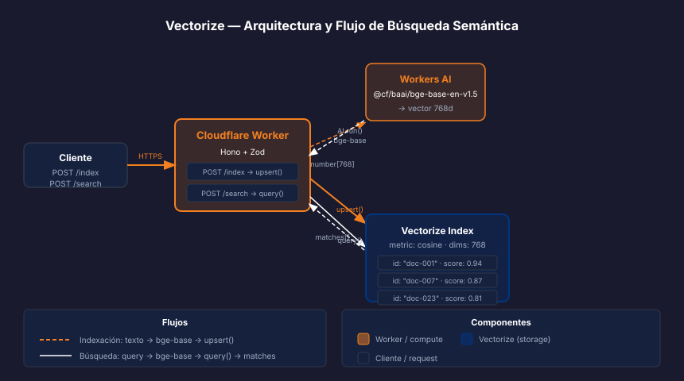

# Vectorize — Vector Database en el Edge

> 

## Objetivos

- Explicar qué es una base de datos vectorial y por qué se usa en AI
- Crear un índice Vectorize con `wrangler` y configurar el binding
- Identificar las métricas de similitud disponibles y cuándo usar cada una

## 1. Qué es Vectorize

Vectorize es la base de datos vectorial de Cloudflare, diseñada para correr
en el edge junto a Workers. Almacena vectores numéricos de alta dimensión
(llamados embeddings) y permite buscar los más similares a una consulta.

Cada vector tiene:
- **`id`**: string único que identifica el documento
- **`values`**: array de floats (ej. 768 dimensiones para `bge-base-en-v1.5`)
- **`metadata`**: objeto JSON arbitrario (filtrable en la búsqueda)

## 2. Crear un índice

Con `wrangler` se crea el índice especificando dimensiones y métrica:

```bash
# Índice de 768 dimensiones, similitud coseno (para embeddings de texto)
wrangler vectorize create mi-indice --dimensions=768 --metric=cosine
```

Las métricas disponibles son:

| Métrica | Cuándo usar |
|---------|-------------|
| `cosine` | Embeddings de texto (semántica) |
| `euclidean` | Vectores geoespaciales o numéricos |
| `dot-product` | Modelos de recomendación normalizados |

> Elige `cosine` para cualquier caso de búsqueda semántica con texto.

## 3. Declarar el binding en wrangler.jsonc

```jsonc
{
  "name": "mi-worker",
  "main": "src/index.ts",
  "compatibility_date": "2025-01-01",
  "compatibility_flags": ["nodejs_compat_v2"],
  "vectorize": [
    {
      "binding": "VECTORIZE",
      "index_name": "mi-indice"
    }
  ]
}
```

En TypeScript se tipa como `VectorizeIndex`:

```typescript
type Bindings = {
  VECTORIZE: VectorizeIndex; // tipo nativo de @cloudflare/workers-types
};
```

## 4. Límites del plan gratuito

| Recurso | Límite gratuito |
|---------|----------------|
| Índices | 5 |
| Vectores por índice | 200 000 |
| Dimensiones máximas | 1536 |

> Ver límites actualizados en [developers.cloudflare.com/vectorize/platform/limits](https://developers.cloudflare.com/vectorize/platform/limits/)

## ✅ Checklist

- [ ] ¿Qué tres propiedades tiene un vector en Vectorize (`id`, `values`, `metadata`)?
- [ ] ¿Qué comando crea un índice de 768 dimensiones con métrica coseno?
- [ ] ¿Qué tipo TypeScript representa el binding `VECTORIZE` en `Bindings`?
- [ ] ¿Cuándo elegirías `euclidean` en lugar de `cosine`?

## Referencias

- [Vectorize · Overview](https://developers.cloudflare.com/vectorize/)
- [Create an index](https://developers.cloudflare.com/vectorize/get-started/intro/)
