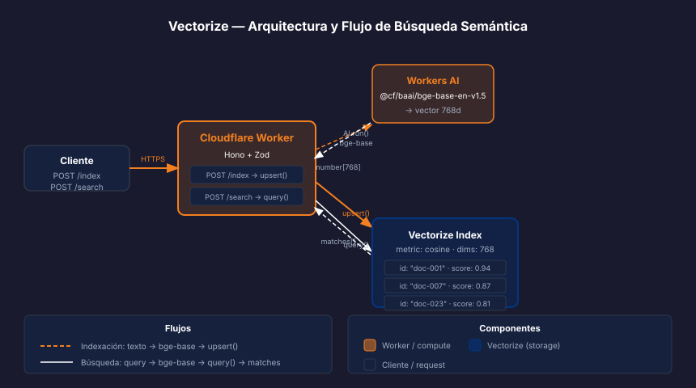

# Operaciones CRUD en Vectorize

> 

## Objetivos

- Insertar y actualizar vectores con `insert` y `upsert`
- Adjuntar metadata a cada vector para filtrar búsquedas
- Eliminar vectores por ID y recuperarlos con `getByIds`

## 1. insert vs upsert

`insert` falla si ya existe un vector con el mismo `id`.
`upsert` sobreescribe el vector si el `id` ya existe — es el método preferido.

```typescript
// Inserta o sobreescribe vectores en el índice
await c.env.VECTORIZE.upsert([
  {
    id: "doc-001",
    values: [0.12, -0.45, 0.78 /* … 768 dims en total */],
    metadata: { title: "Guía de Workers KV", category: "storage", lang: "es" },
  },
  {
    id: "doc-002",
    values: [0.33, 0.11, -0.62 /* … */],
    metadata: { title: "Introducción a D1", category: "database", lang: "es" },
  },
]);
```

El binding `VECTORIZE` expone los métodos `insert()` y `upsert()`.
Ambos aceptan un array de objetos `VectorizeVector`.

## 2. Estructura de VectorizeVector

```typescript
type VectorizeVector = {
  id: string;           // identificador único del documento
  values: number[];     // el embedding (longitud = dimensiones del índice)
  metadata?: Record<string, string | number | boolean>;
  namespace?: string;   // aísla subconjuntos dentro del mismo índice
};
```

> `metadata` solo admite valores escalares: string, number o boolean.
> No puedes almacenar objetos anidados ni arrays en metadata.

## 3. Eliminar vectores por ID

```typescript
// Elimina vectores del índice dado sus IDs
await c.env.VECTORIZE.deleteByIds(["doc-001", "doc-002"]);
```

## 4. Recuperar vectores por ID

```typescript
// Obtiene los vectores con sus values y metadata
const result = await c.env.VECTORIZE.getByIds(["doc-001", "doc-003"]);
// result.vectors es un array de VectorizeVector
```

`getByIds` es útil para verificar que un upsert fue exitoso o para recuperar
metadata sin hacer una búsqueda semántica.

## 5. Ejemplo: endpoint de carga masiva

```typescript
import { Hono } from "hono";
import { zValidator } from "@hono/zod-validator";
import { z } from "zod";

type Bindings = { VECTORIZE: VectorizeIndex };
const app = new Hono<{ Bindings: Bindings }>();

const vectorSchema = z.object({
  id: z.string().min(1),
  values: z.array(z.number()).length(768),
  metadata: z.record(z.union([z.string(), z.number(), z.boolean()])).optional(),
});

// Carga un lote de vectores al índice
app.post("/vectors", zValidator("json", z.array(vectorSchema)), async (c) => {
  const vectors = c.req.valid("json");
  const result = await c.env.VECTORIZE.upsert(vectors);
  return c.json({ mutationId: result.mutationId, count: vectors.length }, 201);
});

export default app;
```

> `upsert` devuelve un objeto con `mutationId` — úsalo para rastrear la operación.

## ✅ Checklist

- [ ] ¿Cuándo usarías `insert` en lugar de `upsert`?
- [ ] ¿Qué tipos de valores acepta el campo `metadata` de un vector?
- [ ] ¿Qué método elimina vectores del índice dado un array de IDs?
- [ ] ¿Qué propiedad devuelve `upsert` para rastrear la mutación?

## Referencias

- [Vectorize · Workers binding API](https://developers.cloudflare.com/vectorize/reference/client-api/)
- [VectorizeVector type](https://developers.cloudflare.com/vectorize/reference/client-api/#vectorizevector)
