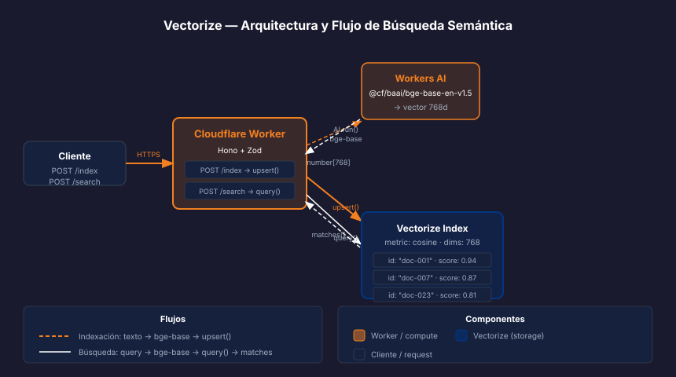

# Búsqueda Semántica con Vectorize

> 

## Objetivos

- Ejecutar una búsqueda ANN con `query()` y leer los resultados
- Filtrar resultados por metadata para reducir el espacio de búsqueda
- Interpretar el score de similitud y el parámetro `topK`

## 1. El método query()

`query()` recibe un vector de consulta y devuelve los `topK` vectores más
similares del índice según la métrica configurada (coseno, euclidiana, etc.).

```typescript
const results = await c.env.VECTORIZE.query(queryVector, {
  topK: 5,
  returnMetadata: "all",  // "none" | "indexed" | "all"
  returnValues: false,    // true devuelve también el array de floats
});
```

`results.matches` es un array de objetos `VectorizeMatch`:

```typescript
type VectorizeMatch = {
  id: string;
  score: number;   // 0–1 para coseno; mayor = más similar
  metadata?: Record<string, string | number | boolean>;
  values?: number[];
};
```

> Un score coseno > 0.85 indica alta similitud semántica entre dos textos.

## 2. Filtrar por metadata

Agrega `filter` a la llamada para limitar la búsqueda a un subconjunto:

```typescript
// Solo busca en vectores donde category === "storage"
const results = await c.env.VECTORIZE.query(queryVector, {
  topK: 3,
  returnMetadata: "all",
  filter: { category: "storage" },
});
```

Los filtros soportan igualdad (`===`). Para filtrarlo por rango, ordena los
resultados en el Worker después de recibirlos.

> Vectorize solo indexa para filtrado las claves de metadata marcadas como
> `indexed` al crear el índice con `--metadata-index-key`.

## 3. Namespaces: sub-particionamiento del índice

Un namespace aísla vectores dentro del mismo índice sin crear uno nuevo:

```typescript
// Upsert en el namespace "en"
await c.env.VECTORIZE.upsert([{ id: "doc-01", values: [...], namespace: "en" }]);

// Query limitado al namespace "en"
const results = await c.env.VECTORIZE.query(v, { topK: 5, namespace: "en" });
```

Útil para separar documentos por idioma, cliente o versión de modelo.

## 4. Endpoint de búsqueda completo

```typescript
import { Hono } from "hono";
import { zValidator } from "@hono/zod-validator";
import { z } from "zod";

type Bindings = { VECTORIZE: VectorizeIndex };
const app = new Hono<{ Bindings: Bindings }>();

const querySchema = z.object({
  vector: z.array(z.number()).length(768),
  topK: z.number().int().min(1).max(20).default(5),
  category: z.string().optional(),
});

// Devuelve los k vecinos más cercanos al vector recibido
app.post("/search", zValidator("json", querySchema), async (c) => {
  const { vector, topK, category } = c.req.valid("json");
  const filter = category ? { category } : undefined;
  const result = await c.env.VECTORIZE.query(vector, {
    topK,
    returnMetadata: "all",
    filter,
  });
  return c.json(result.matches);
});

export default app;
```

## ✅ Checklist

- [ ] ¿Qué parámetro controla cuántos resultados devuelve `query()`?
- [ ] ¿Qué valor de score coseno indica alta similitud semántica?
- [ ] ¿Cómo se filtra una búsqueda a vectores de una categoría específica?
- [ ] ¿Para qué sirven los namespaces en Vectorize?

## Referencias

- [Vectorize · query()](https://developers.cloudflare.com/vectorize/reference/client-api/#query-vectors)
- [Metadata filtering](https://developers.cloudflare.com/vectorize/reference/metadata-filtering/)
