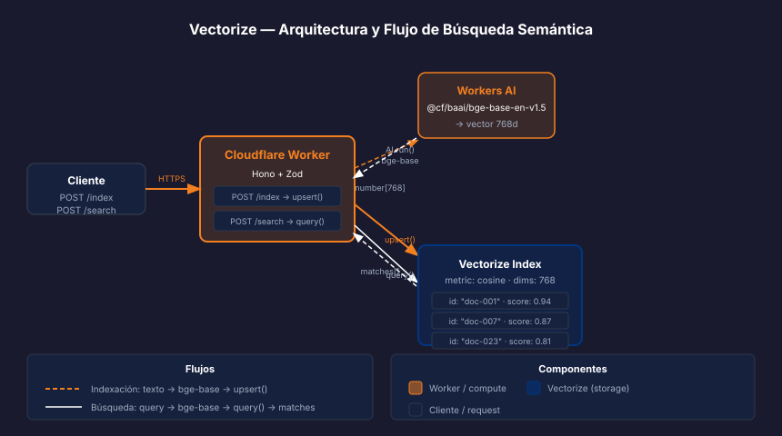

# Workers AI + Vectorize: Búsqueda Semántica End-to-End

> 

## Objetivos

- Generar embeddings con Workers AI y almacenarlos en Vectorize
- Implementar el flujo completo: texto → embedding → upsert → query
- Preparar la base del pipeline RAG que se completará en la semana 13

## 1. El flujo completo

```
[Texto] → AI.run(bge-base) → [Vector 768d] → VECTORIZE.upsert()
[Query] → AI.run(bge-base) → [Vector 768d] → VECTORIZE.query() → [Top-K docs]
```

Tanto la indexación como la búsqueda usan el mismo modelo de embeddings para
garantizar que los vectores estén en el mismo espacio semántico.

## 2. Generar un embedding con Workers AI

```typescript
type Bindings = { AI: Ai; VECTORIZE: VectorizeIndex };

// Genera un embedding de 768 dimensiones para el texto dado
async function getEmbedding(ai: Ai, text: string): Promise<number[]> {
  const result = await ai.run("@cf/baai/bge-base-en-v1.5", {
    text: [text],
  });
  return result.data[0]; // array de 768 floats
}
```

> El modelo `@cf/baai/bge-base-en-v1.5` genera vectores de 768 dimensiones.
> El índice Vectorize debe crearse con `--dimensions=768`.

## 3. Indexar un documento

```typescript
// Indexa un documento: genera embedding y lo guarda en Vectorize
app.post("/index", zValidator("json", indexSchema), async (c) => {
  const { id, text, metadata } = c.req.valid("json");
  const values = await getEmbedding(c.env.AI, text);
  await c.env.VECTORIZE.upsert([{ id, values, metadata }]);
  return c.json({ id, dims: values.length }, 201);
});
```

## 4. Buscar por texto (query semántica)

```typescript
// Convierte la query en embedding y busca los documentos más similares
app.post("/search", zValidator("json", searchSchema), async (c) => {
  const { query, topK } = c.req.valid("json");
  const queryVector = await getEmbedding(c.env.AI, query);
  const result = await c.env.VECTORIZE.query(queryVector, {
    topK: topK ?? 5,
    returnMetadata: "all",
  });
  return c.json(result.matches);
});
```

El resultado incluye los documentos semánticamente más parecidos a la query,
sin necesidad de coincidencias exactas de palabras clave.

## 5. wrangler.jsonc con ambos bindings

```jsonc
{
  "name": "semantic-search",
  "main": "src/index.ts",
  "compatibility_date": "2025-01-01",
  "compatibility_flags": ["nodejs_compat_v2"],
  "ai": { "binding": "AI" },
  "vectorize": [
    { "binding": "VECTORIZE", "index_name": "knowledge-base" }
  ]
}
```

## ✅ Checklist

- [ ] ¿Por qué indexación y búsqueda usan el mismo modelo de embeddings?
- [ ] ¿Cuántas dimensiones genera `@cf/baai/bge-base-en-v1.5`?
- [ ] ¿Qué dos bindings necesita un Worker de búsqueda semántica?
- [ ] ¿Cómo continuará este flujo en el proyecto RAG de la semana 13?

## Referencias

- [Workers AI + Vectorize tutorial](https://developers.cloudflare.com/vectorize/get-started/embeddings/)
- [bge-base-en-v1.5 model](https://developers.cloudflare.com/workers-ai/models/bge-base-en-v1.5/)
