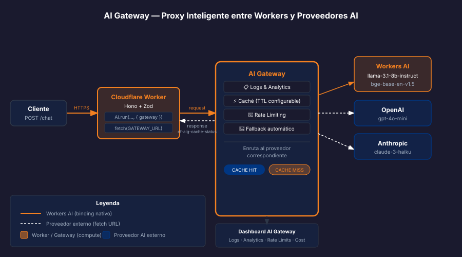

# AI Gateway — Proxy Inteligente para Modelos AI

> 

## Objetivos

- Explicar qué es AI Gateway y qué tráfico intercepta
- Crear un gateway en el dashboard y localizar su ID y URL base
- Identificar las cuatro funcionalidades principales del gateway

## 1. Qué es AI Gateway

AI Gateway es un proxy reverso de Cloudflare que se sitúa entre tu Worker y
cualquier proveedor de AI (Workers AI, OpenAI, Anthropic, etc.). Intercepta
cada llamada de inferencia sin modificar el código de tu aplicación.

Beneficios inmediatos:
- **Observabilidad**: logs, métricas y latencia de cada llamada en el dashboard
- **Caching**: respuestas idénticas se sirven desde caché sin llamar al modelo
- **Rate limiting**: evita gastos inesperados por abuso o error de código
- **Fallback**: si un proveedor falla, reintenta con otro automáticamente

## 2. Crear un gateway en el dashboard

1. Dashboard → AI → AI Gateway → **Create Gateway**
2. Escribe un **Gateway name** (slug, p. ej. `mi-gateway`)
3. Confirma — obtendrás el **Gateway ID** y la **URL base**:

```
https://gateway.ai.cloudflare.com/v1/{ACCOUNT_ID}/{GATEWAY_NAME}
```

> El `ACCOUNT_ID` se encuentra en la home del dashboard → Account ID.

## 3. Endpoints por proveedor

Cada proveedor tiene su prefijo bajo la URL base:

| Proveedor | Sufijo del endpoint |
|-----------|---------------------|
| Workers AI | `/workers-ai/{model}` |
| OpenAI | `/openai` |
| Anthropic | `/anthropic` |
| Azure OpenAI | `/azure-openai/{resource}/{deployment}` |

Para usar Workers AI con el binding nativo, no es necesario construir la URL
manualmente: se pasa el `gateway.id` como opción al método `run()`.

## 4. Dashboard de AI Gateway

El dashboard muestra por cada gateway:
- **Requests**: total de llamadas, tasa de caché hit, errores
- **Logs**: cada request con prompt (si se activa), latencia, tokens usados
- **Cost**: estimación de coste por proveedor
- **Rate Limits**: configuración de ventana y límite de requests

> Los logs de prompts están desactivados por defecto por privacidad.
> Actívalos solo en entornos de desarrollo o con consentimiento explícito.

## ✅ Checklist

- [ ] ¿Dónde se obtiene el `ACCOUNT_ID` y el `GATEWAY_NAME` de un gateway?
- [ ] ¿Qué cuatro funcionalidades principales aporta AI Gateway?
- [ ] ¿Qué sufijo usa el endpoint de Workers AI en la URL base del gateway?
- [ ] ¿Por qué los logs de prompts están desactivados por defecto?

## Referencias

- [AI Gateway · Overview](https://developers.cloudflare.com/ai-gateway/)
- [Get started](https://developers.cloudflare.com/ai-gateway/get-started/)
