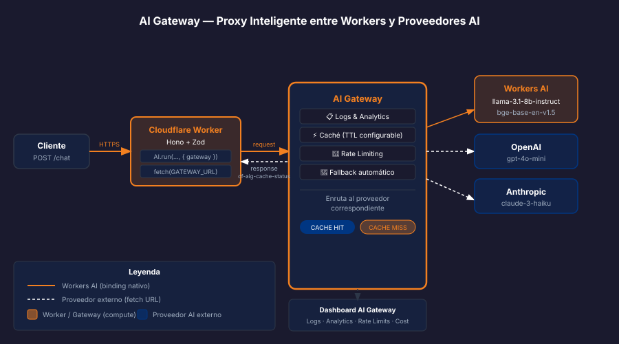

# Workers AI con AI Gateway

> 

## Objetivos

- Pasar el gateway ID al binding `AI` sin cambiar la lógica de inferencia
- Entender qué headers devuelve el gateway para indicar caché hit/miss
- Agregar metadata de request para identificar llamadas en los logs

## 1. La opción `gateway` en `AI.run()`

El binding `AI` acepta un tercer argumento con opciones del gateway.
Solo es necesario indicar el `id` del gateway creado en el dashboard:

```typescript
const result = await c.env.AI.run(
  "@cf/meta/llama-3.1-8b-instruct",
  {
    messages: [
      { role: "system", content: "Eres un asistente técnico." },
      { role: "user", content: userMessage },
    ],
    max_tokens: 512,
  },
  {
    gateway: {
      id: "mi-gateway",        // slug del gateway en el dashboard
      skipCache: false,        // false = usar caché si existe
      cacheTtl: 3600,          // segundos que vive la respuesta en caché
    },
  }
);
```

> `id` es el nombre del gateway (slug), no el `ACCOUNT_ID`.
> No se necesita la URL completa — el binding la construye internamente.

## 2. Metadata de request

Añade `metadata` para identificar llamadas en los logs del dashboard:

```typescript
{
  gateway: {
    id: "mi-gateway",
    skipCache: false,
    cacheTtl: 3600,
    metadata: {
      userId: "user-123",
      feature: "chat",
      version: "2",
    },
  },
}
```

Los campos de metadata aparecen en la columna **Metadata** de los logs.
Útil para correlacionar llamadas con usuarios o features del producto.

## 3. Header de respuesta: `cf-aig-cache-status`

El gateway añade el header `cf-aig-cache-status` a cada respuesta:

| Valor | Significado |
|-------|-------------|
| `HIT` | Respuesta servida desde caché |
| `MISS` | Se llamó al modelo (no había caché) |
| `BYPASS` | `skipCache: true` o respuesta no cacheable |

## 4. Ejemplo completo de endpoint

```typescript
import { Hono } from "hono";
import { zValidator } from "@hono/zod-validator";
import { z } from "zod";

type Bindings = { AI: Ai };
const app = new Hono<{ Bindings: Bindings }>();

const chatSchema = z.object({ message: z.string().min(1).max(2000) });

// Llama al LLM a través del gateway con caché de 1 hora
app.post("/chat", zValidator("json", chatSchema), async (c) => {
  const { message } = c.req.valid("json");
  const result = await c.env.AI.run(
    "@cf/meta/llama-3.1-8b-instruct",
    { messages: [{ role: "user", content: message }], max_tokens: 512 },
    { gateway: { id: "mi-gateway", skipCache: false, cacheTtl: 3600 } }
  );
  return c.json({ reply: (result as { response: string }).response });
});

export default app;
```

## ✅ Checklist

- [ ] ¿En qué argumento de `AI.run()` se pasa la opción `gateway`?
- [ ] ¿Qué header indica si la respuesta vino de caché?
- [ ] ¿Para qué sirve el campo `metadata` en las opciones del gateway?
- [ ] ¿Cuándo usarías `skipCache: true`?

## Referencias

- [Workers AI · Use AI Gateway](https://developers.cloudflare.com/ai-gateway/providers/workersai/)
- [AI Gateway · Configuration](https://developers.cloudflare.com/ai-gateway/configuration/)
