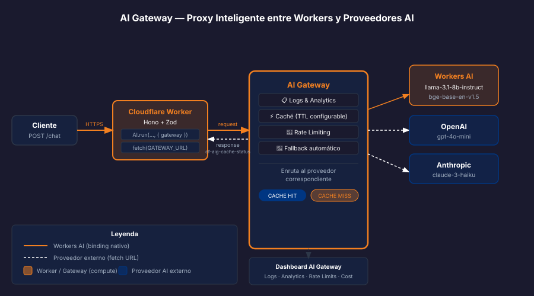

# Caché y Rate Limiting en AI Gateway

> 

## Objetivos

- Configurar el TTL de caché y entender qué respuestas se pueden cachear
- Activar rate limiting en el gateway para proteger el presupuesto
- Forzar bypass de caché para casos donde la frescura es prioritaria

## 1. Cómo funciona la caché del gateway

El gateway almacena la respuesta de una llamada usando como clave el hash del
**modelo + inputs completos**. Si llega una request idéntica dentro del TTL,
se devuelve la respuesta cacheada sin llamar al modelo.

Condiciones para que una respuesta sea cacheable:
- `skipCache: false` (valor por defecto)
- La respuesta no es un stream (`stream: true` no se cachea)
- El proveedor devolvió status 200

```typescript
// Cachea por 2 horas — ideal para preguntas frecuentes
{ gateway: { id: "mi-gateway", skipCache: false, cacheTtl: 7200 } }

// Fuerza llamada al modelo — ignora caché existente
{ gateway: { id: "mi-gateway", skipCache: true } }
```

> `cacheTtl` se expresa en segundos. El máximo es `2592000` (30 días).

## 2. Rate limiting en el dashboard

El rate limiting se configura en el gateway, no en el código del Worker.

Pasos en el dashboard:
1. AI Gateway → tu gateway → **Rate Limiting**
2. Define la ventana de tiempo (p. ej. `1 minute`)
3. Define el límite (p. ej. `100 requests`)
4. Elige la acción: `429 Too Many Requests` o enrutar al fallback

Cuando se supera el límite, el gateway devuelve un error 429 con el header
`cf-aig-rate-limit-remaining: 0` — el Worker debe manejarlo:

```typescript
// Manejo defensivo de rate limit desde el Worker
if (!result || (result as { status?: number }).status === 429) {
  return c.json({ error: "rate limit exceeded, retry later" }, 429);
}
```

## 3. Control de costos

Combinar caché + rate limiting minimiza el coste de inferencia:

| Estrategia | Cuándo usarla |
|-----------|---------------|
| `cacheTtl` alto (> 1h) | Preguntas frecuentes, contenido estático |
| `cacheTtl` bajo (< 5min) | Datos que cambian frecuentemente |
| `skipCache: true` | Requests personalizadas por usuario |
| Rate limiting bajo | Proteger presupuesto en producción |

## 4. Ver métricas de caché en el dashboard

Dashboard → AI Gateway → tu gateway → **Analytics**:
- **Cache hit rate**: porcentaje de requests servidas desde caché
- **Total requests**: desglosadas por proveedor
- **Tokens used**: consumo acumulado por modelo

> Un cache hit rate > 30% en producción indica un ahorro significativo.

## ✅ Checklist

- [ ] ¿Qué dos condiciones deben cumplirse para que una respuesta sea cacheable?
- [ ] ¿Dónde se configura el rate limiting: en el Worker o en el dashboard?
- [ ] ¿Qué status HTTP devuelve el gateway cuando se supera el rate limit?
- [ ] ¿Por qué los streams (`stream: true`) no se pueden cachear?

## Referencias

- [AI Gateway · Caching](https://developers.cloudflare.com/ai-gateway/configuration/caching/)
- [AI Gateway · Rate limiting](https://developers.cloudflare.com/ai-gateway/configuration/rate-limiting/)
