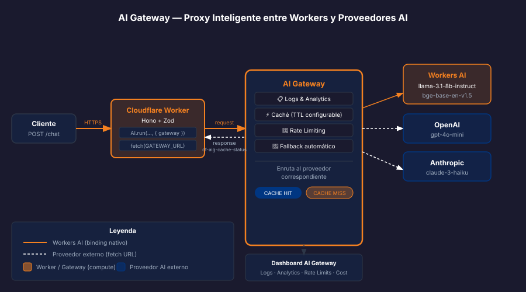

# Proveedores Externos y Fallback Multi-Proveedor

> 

## Objetivos

- Llamar a OpenAI o Anthropic a través de la URL del gateway con `fetch`
- Implementar fallback automático entre proveedores con el endpoint universal
- Entender cuándo usar el endpoint específico vs el universal

## 1. Llamada a proveedor externo vía URL del gateway

Para proveedores distintos de Workers AI, construyes la URL del gateway y
usas `fetch` normalmente — el gateway la proxea al proveedor real:

```typescript
const GATEWAY = `https://gateway.ai.cloudflare.com/v1/${ACCOUNT_ID}/${GATEWAY_NAME}`;

// Llama a OpenAI a través del gateway (los logs aparecen en el dashboard)
const response = await fetch(`${GATEWAY}/openai/chat/completions`, {
  method: "POST",
  headers: {
    "Content-Type": "application/json",
    "Authorization": `Bearer ${c.env.OPENAI_API_KEY}`,
    "cf-aig-cache-ttl": "3600",   // header para controlar TTL desde el código
  },
  body: JSON.stringify({
    model: "gpt-4o-mini",
    messages: [{ role: "user", content: userMessage }],
    max_tokens: 512,
  }),
});
const data = await response.json();
```

> `ACCOUNT_ID` y `GATEWAY_NAME` se guardan como variables de entorno o
> como constantes en el código si no son secretos.

## 2. Endpoint universal con fallback automático

El endpoint universal permite definir una lista de proveedores que se intentan
en orden hasta obtener una respuesta exitosa:

```typescript
// URL base del endpoint universal
const GATEWAY = `https://gateway.ai.cloudflare.com/v1/${ACCOUNT_ID}/${GATEWAY_NAME}`;

// Array de proveedores a intentar en orden
const providers = [
  {
    provider: "workers-ai",
    endpoint: "@cf/meta/llama-3.1-8b-instruct",
    headers: { "Authorization": `Bearer ${c.env.CF_API_TOKEN}` },
    query: { messages, max_tokens: 512 },
  },
  {
    provider: "openai",
    endpoint: "chat/completions",
    headers: { "Authorization": `Bearer ${c.env.OPENAI_API_KEY}` },
    query: { model: "gpt-4o-mini", messages, max_tokens: 512 },
  },
];

const response = await fetch(GATEWAY, {
  method: "POST",
  headers: { "Content-Type": "application/json" },
  body: JSON.stringify(providers),
});
```

Si el primer proveedor falla (timeout, 5xx, rate limit), el gateway pasa al
siguiente automáticamente — sin lógica de retry en el Worker.

## 3. Cuándo usar cada endpoint

| Situación | Endpoint recomendado |
|-----------|----------------------|
| Solo Workers AI | Binding con opción `gateway` |
| Un proveedor externo fijo | URL específica del gateway |
| Alta disponibilidad / cost optimization | Endpoint universal |

## ✅ Checklist

- [ ] ¿Qué header controla el TTL de caché desde el código en lugar del dashboard?
- [ ] ¿Qué formato tiene la URL base del gateway para proveedores externos?
- [ ] ¿Qué ocurre con el endpoint universal si el primer proveedor devuelve 500?
- [ ] ¿Dónde se almacenan `OPENAI_API_KEY` y `CF_API_TOKEN` en un Worker?

## Referencias

- [AI Gateway · Supported providers](https://developers.cloudflare.com/ai-gateway/providers/)
- [AI Gateway · Universal endpoint (fallback)](https://developers.cloudflare.com/ai-gateway/configuration/fallbacks/)
