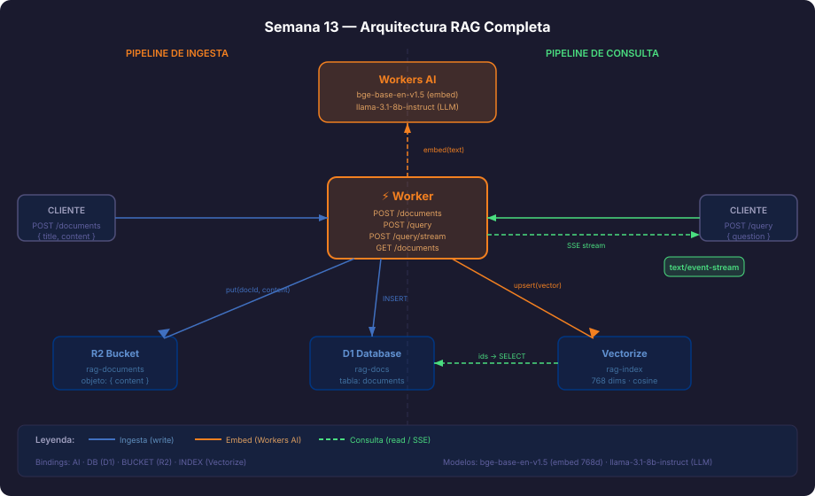

# 01 — RAG: Arquitectura

## Objetivos

1. Entender qué problema resuelve RAG
2. Identificar los dos pipelines: ingesta y consulta
3. Mapear cada componente RAG a un servicio Cloudflare

---

## 1. ¿Qué es RAG?

**Retrieval-Augmented Generation (RAG)** combina búsqueda semántica con
generación de texto. En lugar de depender solo del conocimiento entrenado
del modelo, el LLM recibe fragmentos de tus propios documentos como contexto.

Sin RAG → el modelo responde con conocimiento genérico (o alucina).
Con RAG → el modelo responde basado en tus datos actualizados.

---

## 2. Los dos pipelines



**Pipeline de ingesta** — ejecuta una vez por documento:

```
Documento → R2 (guardar) → D1 (metadata) → Workers AI (embed) → Vectorize (upsert)
```

**Pipeline de consulta** — ejecuta por cada pregunta del usuario:

```
Pregunta → Workers AI (embed) → Vectorize (search topK) → D1 (fetch docs) → LLM → Respuesta
```

---

## 3. Componentes en Cloudflare

| Componente | Servicio Cloudflare | Rol |
|-----------|--------------------|----|
| Almacén de documentos | R2 | Guarda el texto original del documento |
| Metadata y contenido | D1 (SQLite) | Búsqueda por ID, filtrado, metadatos |
| Vectores | Vectorize | Búsqueda semántica por similitud coseno |
| Embeddings + LLM | Workers AI | `bge-base-en-v1.5` + `llama-3.1-8b-instruct` |

---

## 4. Schema D1

```sql
CREATE TABLE IF NOT EXISTS documents (
  id        TEXT PRIMARY KEY,
  title     TEXT NOT NULL,
  content   TEXT NOT NULL,
  r2_key    TEXT NOT NULL,
  created_at TEXT NOT NULL DEFAULT (datetime('now'))
);
```

El campo `r2_key` guarda la clave del objeto en R2 para descarga directa.
El campo `content` almacena el texto para el contexto del LLM sin llamada R2.

---

## Checklist

- [ ] ¿Sabes qué hace cada servicio en el pipeline de ingesta?
- [ ] ¿Entiendes por qué se almacena `content` tanto en D1 como en R2?
- [ ] ¿Puedes trazar el camino de una pregunta hasta la respuesta?
- [ ] ¿Conoces las dimensiones del modelo `bge-base-en-v1.5` (768)?

## Referencias

- [Cloudflare — Vectorize](https://developers.cloudflare.com/vectorize/)
- [Workers AI — Modelos de texto](https://developers.cloudflare.com/workers-ai/models/)
